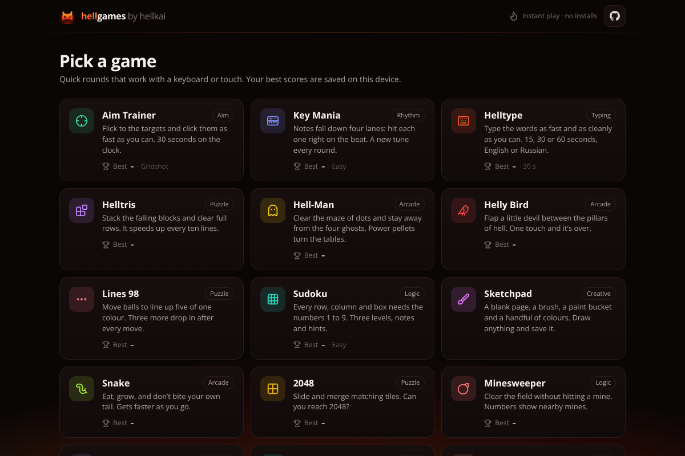
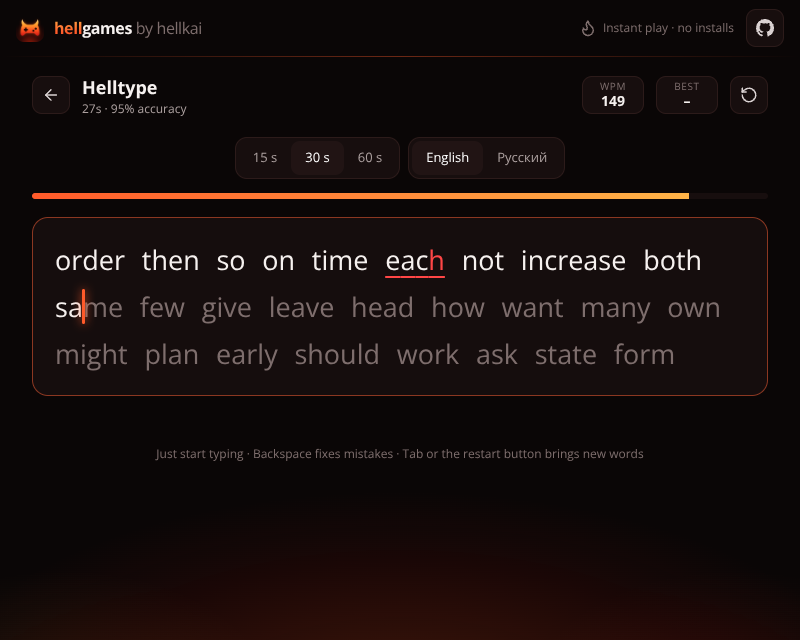
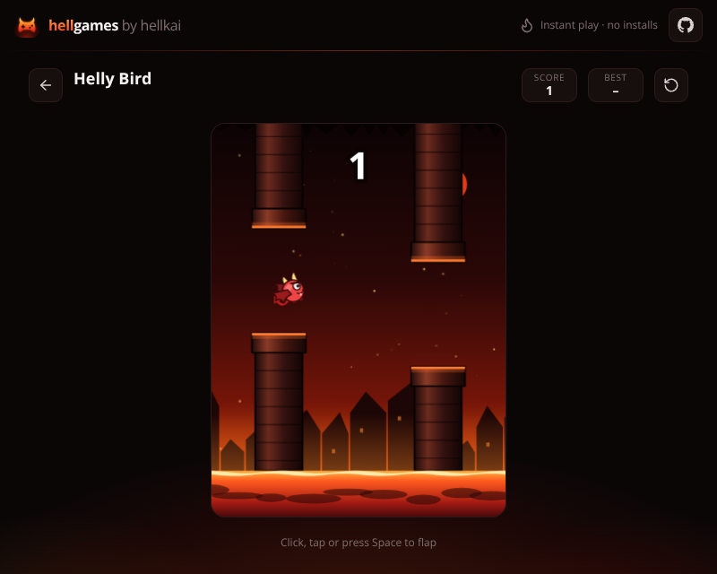
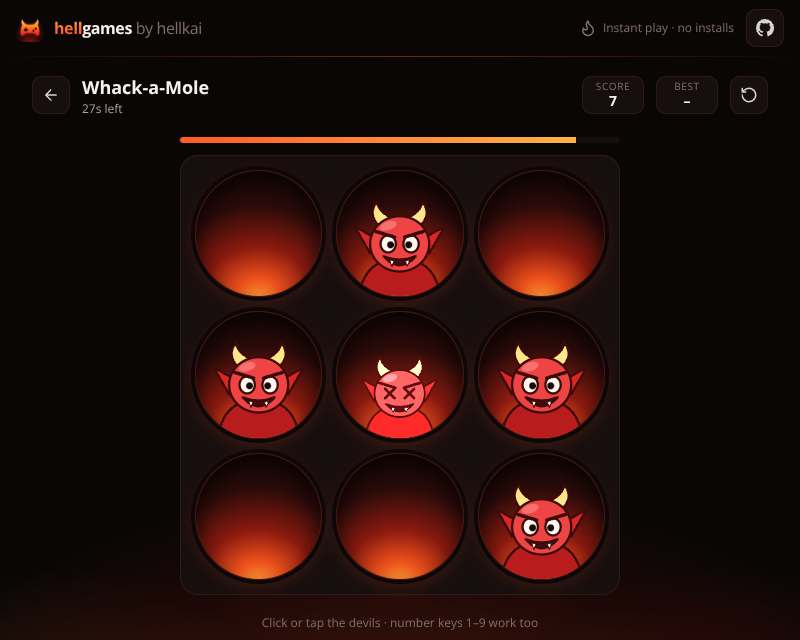
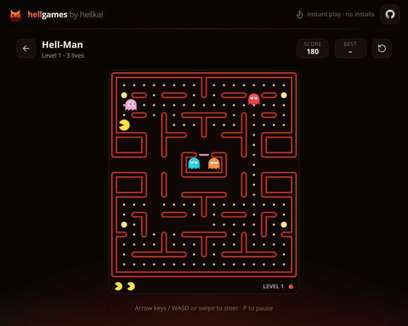
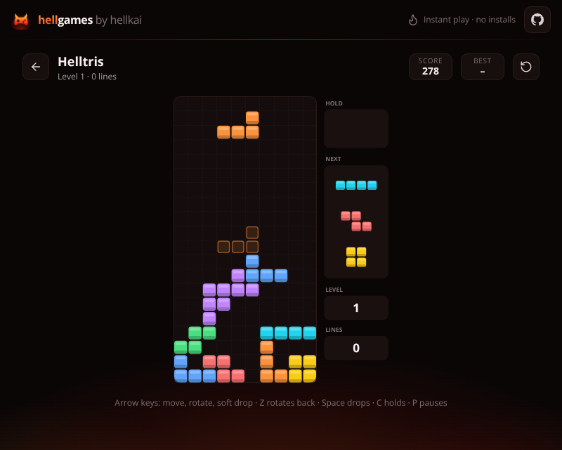
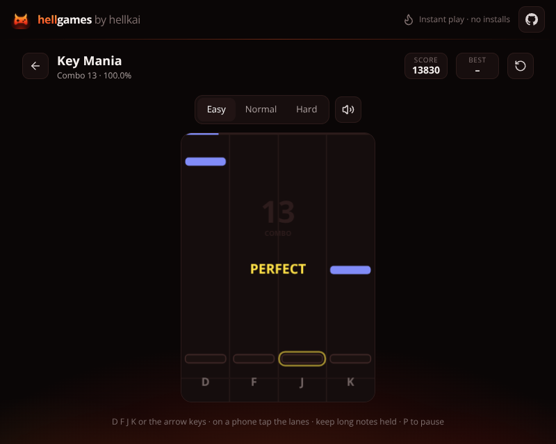

<p align="center"></p>

<h1 align="center">hellgames</h1>

<p align="center">
  Fifteen free mini-games that open straight in the browser, on a computer or a phone.<br>
  No installs, no ads, no sign-up.
</p>

<p align="center">
  <a href="https://hellkxxxi.github.io/HELLGAMES/"><b>▶&nbsp; Play now</b></a>
</p>



## The games

| Game | What you do | Controls |
| --- | --- | --- |
| **Aim Trainer** | Click the targets as fast as you can for 30 seconds. Three modes: Gridshot, Flick and Precision. | Mouse or finger |
| **Key Mania** | A four-lane rhythm game. Every round plays a newly composed tune; hit each note on the beat. Easy, Normal and Hard. | `D` `F` `J` `K` or the arrow keys; on a phone, tap the lanes |
| **Helltype** | A typing-speed test: 15, 30 or 60 seconds of English or Russian words, scored in words per minute. | Any keyboard, including the one on a phone |
| **Helltris** | Falling blocks with a ghost piece, a hold slot and a preview of the next three pieces. | Arrow keys, `Space` to drop, `C` to hold; buttons on a phone |
| **Hell-Man** | Clear a maze of dots while four ghosts, each with a character of its own, hunt you. | Arrow keys, `W` `A` `S` `D` or swipes |
| **Helly Bird** | Flap a little devil between the pillars of hell. One touch and it is over. | Click, tap or `Space` |
| **Lines 98** | Move balls to line up five of one colour. Three more drop in after every move. | Mouse or finger |
| **Sudoku** | Three levels with pencil notes, hints and undo. Every puzzle has exactly one solution. | Mouse or finger, number keys |
| **Sketchpad** | A blank page, a brush, an eraser and a paint bucket. The drawing can be saved as a picture. | Mouse, pen or finger |
| **Snake** | Eat, grow, and don't bite your own tail. | Arrow keys, `W` `A` `S` `D` or swipes |
| **2048** | Slide and merge matching tiles until you reach 2048. | Arrow keys, `W` `A` `S` `D` or swipes |
| **Minesweeper** | Clear the field without digging up a mine. | Click to dig; right-click or long-press to flag |
| **Memory Match** | Find all eight pairs in as few moves as you can. | Mouse or finger |
| **Reaction Test** | Click the moment the screen turns green. The score is the average of five tries. | Click, tap or `Space` |
| **Whack-a-Mole** | Little devils pop out of lava pits. Bop as many as you can in 30 seconds. | Click, tap or the number keys |

Every game lists its controls under the playing field. `Esc` always leads back to the list of games.

<table>
  <tr>
    <td></td>
    <td></td>
    <td></td>
  </tr>
  <tr>
    <td></td>
    <td></td>
    <td></td>
  </tr>
</table>

## Good to know

- **Nothing to install.** Open the link and play, with a keyboard, a mouse or a touch screen.
- **It works offline.** After the first visit the site opens without a connection. *Add to Home Screen* on a
  phone, or *Install* in a desktop browser, turns it into an app with an icon of its own.
- **Your scores stay with you.** Best scores are kept in your browser, on your device. There are no accounts
  and no servers, and nothing is sent anywhere. Clearing the browser's data for the site clears the scores too.
- **No build step.** The site is plain HTML, CSS and JavaScript modules. The files in this repository are
  exactly what the browser gets.

## Run it on your computer

A browser will not run the site from a file opened with a double click, so it needs a local web server.
Any one will do:

```sh
git clone https://github.com/hellkxxxi/HELLGAMES.git
cd HELLGAMES
node tools/serve.mjs            # then open http://localhost:8080
```

or, without Node.js, `python3 -m http.server 8080`.

`tools/serve.mjs` needs nothing but Node.js itself, and it tells the browser never to cache a file, which is
handy while editing.

## What is where

```
index.html          the page: header, list of games, game screen
styles.css          every style of the site and of the games; the colours of the theme are at the top
tailwind.css        generated helper classes, not edited by hand (see "Changing the look")
manifest.json       name, colours and icon for installing the site as an app
sw.js               offline support
icon.png            the one icon of the site
og.png              the picture that messengers show when the link is shared
js/app.js           the host: list of games, navigation, best scores, keyboard, start and result screens
js/util.js          small shared helpers
js/games/           the games, one file each
js/data/words.js    the word lists of Helltype
js/vendor/          the Lucide icon set and its licence
tools/              development tools: local server, tests, artwork scripts (the site itself needs none of it)
docs/               the screenshots on this page
```

The settings of a game (speeds, length of a round, points, colours) are the constants at the top of its file.

## Adding a game

1. Create `js/games/<id>.js`, like the example below.
2. In `js/app.js`, import it and add it to the `games` list. The order of that list is the order on the home page.
3. Put its styles at the end of `styles.css`.

The card on the home page, the address `#<id>`, the best score, the start and result screens and the offline
copy all come from the host. This is a complete game:

```js
// js/games/clicker.js
export default {
  id: 'clicker',                  // also its address: #clicker
  name: 'Clicker',
  icon: 'mouse-pointer-click',    // any name from https://lucide.dev/icons
  color: '#f97316',               // the colour of its card
  tag: 'Reflex',
  desc: 'How many clicks can you make in five seconds?',
  help: 'Click or tap the button as fast as you can',

  // Runs at the start of every round. `stage` is an empty element to build the game in.
  create(stage, api) {
    stage.innerHTML = '<button class="btn-primary" id="hit">Click me</button>';
    let clicks = 0, timer = null;

    stage.querySelector('#hit').addEventListener('click', () => {
      if (!timer) timer = setTimeout(() => api.finish(clicks), 5000); // the first click starts the clock
      api.score(++clicks);
    });

    return {
      destroy() { clearTimeout(timer); }, // the round was left: stop timers and loops here
    };
  },
};
```

For something bigger, `js/games/whack.js` and `js/games/reaction.js` are short games built from page elements,
and `js/games/hellybird.js` is a short one drawn on a canvas.

### What a game can declare

Besides the fields in the example, all of these are optional:

| Field | Meaning |
| --- | --- |
| `variants: { easy: 'Easy', hard: 'Hard' }` | Modes. Each one keeps a best score of its own, and the first is the one a new player starts with. `api.variant()` returns the current mode, `api.variant('hard')` switches to another. |
| `scoreLabel: 'Time'` | The caption of the score box. Without it the caption is "Score". |
| `format(value)` | How a score is written out, for example seconds as `1:05`. |
| `lowerBetter: true` | The lower score is the better one (times, numbers of moves). |
| `noScore: true` | The game has no score. |
| `initialScore: '–'` | What the score box shows before there is a score. Without it, 0. |
| `swipe: true` | The game is steered by swipes, so the page must not scroll under the finger. |

### What `create` can return

Every one of these is optional as well:

| Function | When it is called |
| --- | --- |
| `key(e)` | A key went down. `e` is `{ key, code, repeat, shiftKey, ctrlKey, altKey }`. Letters and digits are named after the physical key (`'w'`, `'1'`), so `W` `A` `S` `D` works in every keyboard layout. Return `true` to keep the browser from acting on the key, such as scrolling the page. |
| `keyup(e)` | A key was released. |
| `shortcut(e)` | A combination with Ctrl, Cmd or Alt was pressed. Return `true` if the game used it. |
| `swipe(direction)` | The player swiped `'up'`, `'down'`, `'left'` or `'right'`. |
| `restart()` | The Restart button was pressed. Without this function the round is simply created again. |
| `destroy()` | The round is over or the player has left. Stop timers, loops and listeners here. |

Keys typed into a text field are left to that field. `Esc` always goes back to the list, and while a start or
result screen is open, `Enter` and `Space` press its button.

### What the host offers

| Call | What it does |
| --- | --- |
| `api.score(value)` | Shows the current score. |
| `api.status(text)` | Shows a short line under the name of the game. |
| `api.finish(score, options)` | Ends the round: saves the score if it is the best so far and shows the result with a *Play again* button. `options.text` replaces the line under the title, `options.endTitle` the title itself ("Game over"). |
| `api.overlay({ title, text, button, icon, onClick })` | Puts a card over the game, such as a start or a pause screen. `onClick` runs when its button is pressed. |
| `api.hideOverlay()` | Takes that card away. |
| `api.variant(id)` | The current mode; see `variants` above. |

`js/util.js` has a few helpers: `fitCanvas` keeps a canvas sharp at any size, `loop` runs an animation,
`noScroll` stops the page from moving under a finger, and there are `shuffle`, `randInt` and `clamp`. Icons
are written as `<i data-lucide="name"></i>`; the host draws the ones present when `create` returns, and
`drawIcons()` draws those added later.

## Adding a language to Helltype

1. In `js/data/words.js`, add a list to `WORDS`: a few hundred common words in lower case, separated by spaces
   or line breaks.
2. In `js/games/helltype.js`, add its name to `LANGS`, for example `de: 'Deutsch'`.

The key is the two-letter code of the language. A visitor whose browser is set to that language starts with
these words.

## Changing the look

- **Colours.** The palette of the whole site is the block of variables at the top of `styles.css`.
- **Icon.** `icon.png` is the only icon file. The browser tab, the header, the home screen of a phone and the
  installed app all use it. To change it, replace the file with a square PNG of the same name, ideally
  512 × 512 pixels. The current one is drawn in `tools/art/icon.svg`.
- **Sharing picture.** `og.png` is rendered from `tools/art/og.html`.
- **`tailwind.css`.** The markup uses some [Tailwind](https://tailwindcss.com) utility classes for layout, such
  as `flex`, `gap-3` and `sm:grid-cols-2`. This file holds exactly the ones in use and is generated, so a
  class that has not been used before does nothing until the file is made again with `npm run css`. Styles of
  your own are easier to write in `styles.css`. The page has to load `tailwind.css` after `styles.css`.

## Development tools

Everything in `tools/` is optional and needs [Node.js](https://nodejs.org) 22 or newer.

```sh
cd tools
npm install
npm test                # the rules of the games, then the whole site in a real browser
npm test -- unit        # only the tests that need no browser
npm test -- helltype    # only one of the browser tests; their names are the files in tools/browser
npm run serve           # the local server, http://localhost:8080
npm run css             # make tailwind.css again
npm run art             # render icon.png, og.png and the screenshots in docs/
```

The browser tests drive Chrome or Chromium. They look for the one installed on the computer, and
`CHROME_PATH` points them to it if it is in an unusual place. On Linux without a browser they use a headless
build that `npm install` downloads.

## Hosting a copy of your own

The site is a folder of static files, so any static hosting will do: upload the files as they are. On GitHub
Pages, fork the repository and choose *Settings → Pages → Deploy from a branch*, the branch `main` and the
folder `/ (root)`. The empty file `.nojekyll` tells GitHub Pages to publish the files untouched.

Two things in `index.html` carry the address of this copy and should be changed in yours: the `canonical`,
`og:url` and `og:image` lines at the top, and the two links to the repository.

## Contributing

Bug reports and ideas are welcome in the [issues](https://github.com/hellkxxxi/HELLGAMES/issues), and so are
pull requests. Please run `npm test` in `tools/` before sending one.

## Licence

[MIT](LICENSE) © hellkai
